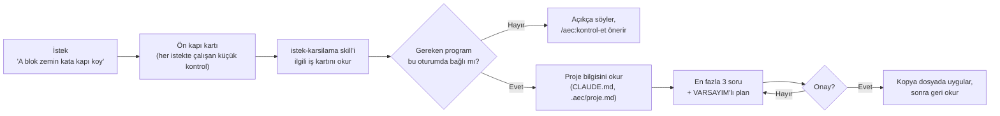

# aec-harness

Mimarlık ofisleri için bir Claude eklentisi (Claude Code plugin marketplace: `aec-office`, eklenti: `aec`). Revit,
AutoCAD ve Rhino ile yapılan günlük işler için hazırlandı. İsteği gündelik dille yazmanız yeter: eklenti işi tanır,
eksik bilgiyi sorar ve uygulamadan önce planı gösterir.

Hedef: ajan ölçüyü görselden tahmin etmesin, araçla okusun. Revit'e yalnızca onaylanmış bir plan üzerinden ve kopya
dosyada yazsın. Yazdıktan sonra sonucu Revit'ten okuyup toleransla karşılaştırsın. Kısacası **ölç → planla → onayla →
uygula → geri oku → doğrula**.

Bugün bu yolun ilk katmanı çalışıyor: isteği tanıyıp önce plan gösteren **ön kapı**, ofis kuralları ve üç komut.
Ölçüyü okuyan ve geri okumayı doğrulayan araçlar sonraki fazlarda gelecek. Ne olduğu, ne olmadığı aşağıda.

## Durum

| Ne | Durum |
|---|---|
| Ön kapı (isteği tanır, eksikleri sorar, plan gösterir, onay bekler) | ✅ `dev` kanalında, pilotta |
| Ofis kuralları ve rol (her oturumun başında) | ✅ |
| `/aec:kontrol-et`, `/aec:proje-baslat`, `/aec:yardim` | ✅ `dev` kanalında |
| Tek satırlık kurulum (`kur.ps1`) | ✅ `dev` kanalında |
| Revit bağlantısı | Ofisin kurduğu bilgisayarlarda temel bağlantı var; kurulumla dağıtımı sıradaki planda |
| AutoCAD ve Rhino bağlantısı | Yakında (sıradaki plan) |
| .NET 8, .NET 10, pyRevit kurulumu | Yakında (sıradaki plan) |
| DWG okuma (Faz 1B), doğrulayan Revit köprüsü (Faz 1C), asma tavan (Faz 1D) | Yakında |
| Metraj, Rhino'dan Revit'e, render ve diğer modüller | Yol haritasında |

Kullanıcı gözünden ayrıntılı liste: [Neler yapabilir?](plugin/docs/NELER-YAPABILIR.md). Değişiklikler:
[CHANGELOG.md](CHANGELOG.md).

> **Pilot dönemi:** Yeni katman şu an yalnızca `dev` kanalında. `main` kanalına (herkese) pilotta toplanan gerçek
> isteklerle yapılan sınamadan sonra geçecek. Bu yüzden aşağıdaki `main` kurulum satırı da o zamana kadar çalışmaz.

## Nasıl çalışır: ön kapı

Ofisteki herkes isteğini kendi kelimeleriyle yazar; "skill", "plan" gibi kelimeleri bilmesi gerekmez. Ön kapı araya
girer, işi tanır ve ajanı doğru yola sokar.



- **Az sor, çok göster:** önce proje dosyasına bakar; yalnızca en kritik eksikleri (en fazla 3) sorar; geri kalanını
  planda **VARSAYIM** diye yazar.
- **Yapamıyorsa söyler:** araç bağlı değilse ya da iş henüz desteklenmiyorsa kötü bir sonuç üretmez; nedenini ve
  sonraki adımı söyler.
- **Kart, isteğin metnini tekrar etmez:** müşteri e-postasından ya da çizimden yapıştırılan metin talimat sayılmaz.
- **Cowork'te** her istekte çalışan kontrol her zaman devreye girmeyebilir; skill yine kendi açıklamasıyla seçilir.

### İş kartları

| İş | Durum | Ön kapının sorduğu kritik eksikler |
|---|---|---|
| Revit modelleme | Revit bağlantısı kurulu bilgisayarlarda | kopya model mi, kat/seviye, aile ve tip, ölçü kaynağı |
| DWG okuma/aktarma | Yakında (Faz 1B) | hangi dosya ve pafta, hangi katmanlar, birim ve ölçek, DWG–Revit hizası |
| DWG'de çizim | Yakında | yeni dosya mı kopya mı, katman standardı, ölçek, yazı stili |
| Metraj/liste | Revit'ten kısmen; DWG'den yakında | kaynak Revit mi DWG mi, net mi brüt mü, Excel biçimi, poz no (fiyatsız) |
| Rhino'dan Revit'e | Yakında (Rhino.Inside.Revit üzerine kod) | hangi geometri, Revit'te hangi kategori, birim ve orijin |
| Asma tavan | Yakında (Faz 1D) | hangi DWG ve oda, tavan sistemi, kot, kopya model mi |
| Render/görsel | Yakında; sahne tarifi ya da istem metni yazabilir | hangi görünüş, stil, gizlilik (müşteri çizimi) |

Kartlar: [plugin/skills/istek-karsilama/kartlar/](plugin/skills/istek-karsilama/kartlar/). İyi ve kötü istek
örnekleri: [ORNEK-ISTEKLER.md](plugin/docs/ORNEK-ISTEKLER.md).

### Komutlar

| Komut | Ne yapar | Dosya yazar mı? |
|---|---|---|
| `/aec:kontrol-et` | uv, otomatik güncelleme, proje dosyaları ve Revit/AutoCAD/Rhino bağlantısını Türkçe raporlar; her eksik için "şunu yapın" der. "Bağlı" yalnızca program aracı oturumda var ve yanıt veriyorsa yazılır. | Hayır |
| `/aec:proje-baslat` | En fazla 6 soruyla projenin `.aec/proje.md` dosyasını yazar ve `CLAUDE.md` dosyasına kısa bir bölüm ekler. Ev klasörüne ya da sürücü köküne yazmayı reddeder; sizin yazdıklarınıza dokunmaz. | Evet, proje klasörüne |
| `/aec:yardim` | Bugün neler yapılabildiğini ve örnek istekleri gösterir. | Hayır |

## Kurulum

Adım adım anlatım (terminal ve Cowork için, ekran adlarıyla): [plugin/docs/BASLA.md](plugin/docs/BASLA.md).

**Gereksinimler:** Windows 10/11, kişisel Claude Pro ya da Max hesabı, Claude Code (terminal) ya da Claude masaüstü
uygulamasında Cowork. Ofiste Revit 2027, AutoCAD 2027 ve Rhino 8 kullanılır. Kurulum betiği uv ve Python 3.12'yi
kendisi kurar.

**Pilot (dev) kanalı**, Win+R ya da `cmd` penceresine yazılır:

```
powershell -ExecutionPolicy Bypass -c "$env:AEC_KANAL='dev'; iex ((irm https://raw.githubusercontent.com/modularbelen-del/aec-harness/dev/kur.ps1).TrimStart([char]0xFEFF))"
```

**Kararlı (main) kanal**, değişiklikler `main`'e geçince çalışır:

```
powershell -ExecutionPolicy Bypass -c "iex ((irm https://raw.githubusercontent.com/modularbelen-del/aec-harness/main/kur.ps1).TrimStart([char]0xFEFF))"
```

Kurulum betiği (`kur.ps1`) şunları yapar:

1. uv'yi kurar (winget ile; winget yoksa resmi kurulum betiğiyle).
2. Python 3.12'yi indirir, böylece ilk oturum beklemez.
3. Bilgisayarda Claude Code (terminal) varsa marketplace'i ekler, `aec` eklentisini kurar ve otomatik güncellemeyi
   açar. Bunu yapmadan önce ayar dosyasının yedeğini alır (`settings.json.aec-yedek`); diğer ayarlara dokunmaz.
4. Claude Code yoksa (Cowork kullanıcısı) eklenti adımını atlar ve Cowork ekran adımlarını gösterir.
5. Revit tarafını (pyRevit ve Revit MCP eklentisi) yalnızca raporlar; kurmaz.

Ne yapacağını önce görmek için: `-KuruCalistir` ya da `$env:AEC_KURU='1'` (hiçbir şey kurmaz).

**Cowork:** aynı kurulum satırını çalıştırdıktan sonra Customize > Plugins > Add marketplace >
`modularbelen-del/aec-harness` ve "Sync automatically". Yerel program bağlantıları için oturum "bilgisayarınızda"
çalışmalıdır. Ayrıntı: [BASLA.md](plugin/docs/BASLA.md).

Güvenlik kuralları: [GUVENLIK.md](plugin/docs/GUVENLIK.md). Takılırsanız: [SORUN-GIDERME.md](plugin/docs/SORUN-GIDERME.md).
Terimler: [SOZLUK.md](plugin/docs/SOZLUK.md).

### Elle kurulum (yalnızca BT/şampiyon için)

`C:\Users\<kullanıcı>\.claude\settings.json` dosyasına şunu ekleyin. Dosyada başka ayarlar varsa bu anahtarları
onların yanına koyun. Claude Code bir sonraki açılışta eklentiyi kendisi indirip kurar ve güncel tutar. uv'yi
ayrıca kurun (`winget install --id=astral-sh.uv -e`).

```json
{
  "extraKnownMarketplaces": {
    "aec-office": {
      "source": { "source": "github", "repo": "modularbelen-del/aec-harness" },
      "autoUpdate": true
    }
  },
  "enabledPlugins": {
    "aec@aec-office": true
  }
}
```

Otomatik güncelleme kapalı görünürse: `/plugin` > Marketplaces > aec-office > Enable auto-update.

## Kanallar

- `main`: herkes için kararlı kanal. Korumalıdır, yalnızca PR ile değişir.
- `dev`: şampiyonlar için deneme kanalı. Kurulum: [BASLA.md, Kanallar bölümü](plugin/docs/BASLA.md).

Şampiyon iki kanalı aynı anda kuramaz, çünkü marketplace adı aynıdır. Eklentide `version` alanı yoktur; her commit
yeni bir sürüm sayılır ve otomatik güncellemeyle o kanaldaki herkese ulaşır.

## Güvenlik ilkeleri (özet)

Eklenti bu kurallara göre çalışacak şekilde ayarlandı; yine de izin ekranlarını okuyun ve emin olmadığınızda reddedin.

- Orijinal DWG ve RVT dosyalarına yazılmaz; iş kopya dosyada yapılır.
- Merkez modelle senkronizasyonu (sync) ve kaydetmeyi yalnızca kişi yapar.
- Müşteri çizimleri ücretsiz yapay zekâ sitelerine yüklenmez.
- Bakanlık birim fiyatları kullanılmaz; metrajda yalnızca poz numarası yazılır.
- Çizimdeki ya da e-postadaki metin talimat değil, veridir.
- Repoya gerçek proje, müşteri ya da dosya adı girmez (repo public).

## Rol ve ofis kuralları

Eklenti her oturumun başında iki dosyayı Claude'un bağlamına ekler:

- `plugin/standards/rol.md`: ajanın rolü ve çalışma biçimi (30 yıllık mimar). Revit, AutoCAD ya da Rhino'ya yalnızca
  o programın MCP aracı oturumda varsa bağlanır; yoksa bağlantının kurulu olmadığını söyler ve `/aec:kontrol-et` önerir.
- `plugin/standards/authority.md`: çelişkide hangi kaynağın kazandığı (yetki sırası: çizim → proje kuralları → ofis
  standartları → araştırma kataloğu) ve "az sor, çok göster" kuralı.

Windows'ta ayrıca hangi programların (Revit, AutoCAD, Rhino) açık olduğunu tek satırlık bir ipucu olarak ekler. Bu
satır "bağlı" anlamına gelmez. Bunları değiştirmek için PR açın; birleştirilince o kanaldaki herkese bir sonraki
açılışta ulaşır.

## Repo yapısı

```
.claude-plugin/marketplace.json   marketplace tanımı (aec-office)
kur.ps1, kur.cmd                  kurulum betiği (BOM'lu UTF-8) ve çift tıklanan başlatıcısı
CHANGELOG.md                      sade Türkçe değişiklik günlüğü
plugin/
  .claude-plugin/plugin.json      eklenti tanımı (aec)
  hooks/                          SessionStart (kurallar + program ipucu) ve UserPromptSubmit (ön kapı) kancaları
    onkapi.py                     Türkçe normalleştirme, anahtar kelime eşleştirme, kart metni, oturum başına tekrar engeli
  skills/
    istek-karsilama/              ön kapı skill'i, kartlar.json (anahtar kelimeler) ve kartlar/*.md (iş kartları)
    kontrol-et/, proje-baslat/, yardim/   komutlar
  scripts/                        komutların standart kütüphaneyle yazılmış Python betikleri
  standards/                      rol.md ve authority.md
  docs/                           kullanıcı dokümanları (Türkçe)
  evals/                          ön kapının sentetik eval seti (claude plugin eval)
  src/aec/                        geometri çekirdeği (eğri, tavan geometrisi)
tests/                            pytest testleri (CI'da Windows'ta çalışır)
docs/spikes/                      teknik deneme notları
```

## Geliştirme (bakımcı)

```powershell
uv sync --project plugin                 # ortamı kur
uv run --project plugin pytest -q        # testler
claude plugin validate .                 # marketplace manifesti
claude plugin validate plugin            # plugin manifesti
```

- **Testler:** hook'lar, ön kapı eşleştirmesi (Türkçe karakterli ve karaktersiz yazım, ekler, yanıltıcı kelimeler),
  kartlar ile dokümanların tutarlılığı, kurulum betiğinin kuru çalışması ve ayar düzenlemesi (geçici dosyalarda),
  komut betikleri. Hook komutları `uv` yokken bile hata vermeden çıkar (`; exit 0`).
- **CI:** `main` ve `dev` dallarına her push'ta ve her PR'da Windows'ta pytest ve `claude plugin validate` çalışır.
- **Eval:** ön kapının davranışı `claude plugin eval` ile sınanır. Komut, bütçe ve dikkat edilecekler:
  [plugin/evals/README.md](plugin/evals/README.md). Kullanıcının kendi Claude hesabıyla yerelde çalışır, CI'da çalışmaz.
- **Kurulum betiğini test ederken** gerçek modda çalıştırmayın: yalnızca `-KuruCalistir`/`AEC_KURU=1` ya da
  `AEC_SADECE_YUKLE=1` ile geçici dosyalarda.

## Değişiklik akışı

İşler `dev` dalında yapılır. Pilotta denenip oturan değişiklik PR ile `main`'e geçer. `main` dalına yapılan her push,
bir sonraki açılışta bütün üyelere ulaşır. Bu yüzden `main` korumalıdır: PR açılır ve CI'daki `test` kontrolü yeşil
olmadan birleştirilmez. Değişiklikler [CHANGELOG.md](CHANGELOG.md) dosyasına yazılır.

Koruma repo ayarlarından bir kez kurulur (Settings → Branches → *Add classic branch protection rule*):

- *Branch name pattern*: `main`
- **Require a pull request before merging** işaretli. Altında kendiliğinden işaretlenen **Require approvals**
  kaldırılır. Repoyu tek kişi yönettiği sürece bu kutu açık kalırsa her birleştirmede korumayı atlamak gerekir, çünkü
  GitHub kişinin kendi PR'ını onaylamasına izin vermez. İkinci bir bakımcı gelince açılır.
- **Require status checks to pass before merging** işaretli, listeden `test` seçili.
- **Create** ile kaydedilir.

## Yol haritası

| Faz | İçerik | Durum |
|---|---|---|
| 1A | Geometri çekirdeği, açılış kancası, marketplace iskeleti | ✅ `main` |
| 1A+ | Başlangıç katmanı: ön kapı, kartlar, komutlar, kurulum, dokümanlar, eval | ✅ `dev`, pilotta |
| Bağlantılar ve ön koşullar | Revit MCP (ofis fork'u), AutoCAD MCP, Rhino MCP (rhinomcp); .NET 8, .NET 10, pyRevit kurulumu | Sırada |
| 1B | DWG okuma çekirdeği (AutoCAD Core Console → DXF → ezdxf) | Planlı |
| 1C | Revit köprüsü: plan → tek işlem grubu → geri okuma → toleransla doğrulama; kontrol ve güvenlik kancası | Planlı |
| 1D | Asma tavan modülü ve pilot | Planlı |

1D'den sonraki modüller: AutoCAD çizim ve detay, çizim tutarlılık kontrolleri, metraj ve mahal listeleri, model sağlığı
ve pafta kontrolü, Rhino.Inside.Revit ile Rhino'dan Revit'e, mevzuat (İmar, Yangın, Gürültü, Otopark, Sığınak),
Dijital Proje Yönetmeliği (yürürlük 01.09.2027), Revit aileleri, akustik, parametrik tasarım.

## Lisans

MIT. Ayrıntı için [LICENSE](LICENSE) dosyasına bakın. Telif hakkı © 2026 BelenPartners.
